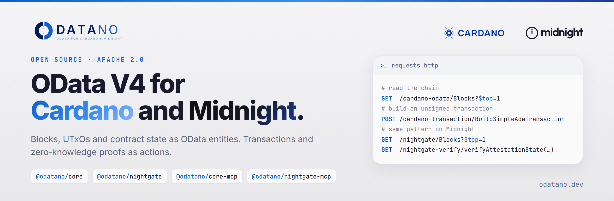

<a href="https://odatano.dev">
  <picture>
    <source media="(prefers-color-scheme: dark)" srcset="assets/banner-night.png">
    
  </picture>
</a>

  <a href="https://odatano.dev">Website</a> ·
  <a href="https://odatano.dev/docs/get-started/">Docs</a> ·
  <a href="https://api.odatano.dev">Hosted API</a> ·
  <a href="https://www.npmjs.com/org/odatano">npm</a>

  
  
  

ODATANO is an open source OData V4 API for Cardano and Midnight. Blocks, UTxOs, pools and contract state are OData entities. Transactions, mints, attestations and zero-knowledge proofs are actions. SAP Fiori, Excel, Power BI, any OData client and AI agents use the same routes.

## Run it

| Mode | How | Start |
|---|---|---|
| **Hosted** | One key for both chains and the analytics, first calls free | [api.odatano.dev](https://api.odatano.dev) |
| **Standalone** | Your own instance on your own backends | [Get started](https://odatano.dev/docs/get-started/) |
| **SAP CAP plugin** | Add the services to an existing CAP app | `npm install @odatano/core` |

The routes are the same in all three. Integrate against the hosted API, move to your own instance later without changes.

## Core

<table>
  <tr>
    <td width="210">
      <a href="https://github.com/ODATANO/ODATANO"><picture>
        <source media="(prefers-color-scheme: dark)" srcset="https://cdn.jsdelivr.net/npm/@odatano/brand@1/logos/odatano-core-logo-on-dark.svg">
        
      </picture></a>
    </td>
    <td><b>Cardano.</b> Blocks, transactions, addresses, UTxOs, assets, pools and DReps as entities. Unsigned ADA, multi-asset, mint, metadata and Plutus V3 transactions. Signing requests, HSM signing and submission. <code>@odatano/core</code></td>
  </tr>
  <tr>
    <td>
      <a href="https://github.com/ODATANO/NIGHTGATE"><picture>
        <source media="(prefers-color-scheme: dark)" srcset="https://cdn.jsdelivr.net/npm/@odatano/brand@1/logos/nightgate-logo.svg">
        
      </picture></a>
    </td>
    <td><b>Midnight.</b> Blocks and contract state as entities. Shielded transfers, Compact contract calls, document anchoring and zero-knowledge attestations. Sponsored, so no NIGHT or DUST is needed. <code>@odatano/nightgate</code></td>
  </tr>
  <tr>
    <td>
      <a href="https://odatano.dev/docs/astra/"><picture>
        <source media="(prefers-color-scheme: dark)" srcset="https://cdn.jsdelivr.net/npm/@odatano/brand@1/logos/astra-logo-on-dark.svg">
        
      </picture></a>
    </td>
    <td><b>Analytics.</b> Key figures, daily tables, rankings and anomalies over both chains as OData. Hosted only, same key.</td>
  </tr>
  <tr>
    <td>
      <a href="https://github.com/ODATANO/ODATANO-CORE-MCP"><picture>
        <source media="(prefers-color-scheme: dark)" srcset="https://cdn.jsdelivr.net/npm/@odatano/brand@1/logos/odatano-mcp-logo-on-dark.svg">
        
      </picture></a>
    </td>
    <td><b>AI agents on Cardano.</b> MCP server that reads the chain and builds transactions. Every build comes back unsigned. <code>@odatano/core-mcp</code></td>
  </tr>
  <tr>
    <td>
      <a href="https://github.com/ODATANO/NIGHTGATE-MCP"><picture>
        <source media="(prefers-color-scheme: dark)" srcset="https://cdn.jsdelivr.net/npm/@odatano/brand@1/logos/nightgate-mcp-logo.svg">
        
      </picture></a>
    </td>
    <td><b>AI agents on Midnight.</b> MCP server for anchoring, attesting and verifying. The agent gets a notary, never a wallet. <code>@odatano/nightgate-mcp</code></td>
  </tr>
</table>

## Built on ODATANO

| Project | What | Chain |
|---|---|---|
| [**DAYPASS**](https://github.com/ODATANO/DAYPASS) | EU battery passport (Reg. 2023/1542). CIP-25 anchors, encrypted tiers, Groth16 predicates on the Cardano ledger. | Cardano |
| [**NIGHTPASS**](https://github.com/ODATANO/NIGHTPASS) | The shielded twin of DAYPASS. Sensitive metrics proven with ZK attestations, values stay hidden. | Midnight |
| [**DPP SDK**](https://github.com/ODATANO/DPP-SDK) | Chain-agnostic core of both passports. Hashing, encryption, Merkle trees, ZK claim planning. | Both |
| [**TRACE**](https://github.com/ODATANO/TRACE) | Pharma batches from manufacturer to pharmacy as NFTs under a Plutus V3 policy. Cold-chain data anchored per handoff. | Cardano |
| [**QUANTIX**](https://github.com/ODATANO/QUANTIX) | B2B raw-material orders settled atomically against Charli3 oracle prices. Charli3 Grand Prize 2026. | Cardano |
| [**FINCA**](https://github.com/ODATANO/FINCA) | Balance sheets and income statements as CIP-10 label-1447 metadata, following the Reeve spec. | Cardano |
| [**x402**](https://github.com/ODATANO/x402) | Payment gating for SAP CAP. OData endpoints return HTTP 402 until on-chain settlement is proven. | Cardano |
| [**DAYZERO**](https://github.com/ODATANO/DAYZERO) | Groth16 proving and verification plus Poseidon hashing on BLS12-381 in pure TypeScript. | Cardano |
| [**WATCH**](https://github.com/ODATANO/WATCH) | Watches addresses, credentials and policies. Emits UTxO events with replay. | Cardano |

<h3 align="center">Questions or a use case in mind: <a href="https://odatano.dev/#contact">odatano.dev</a></h3>
